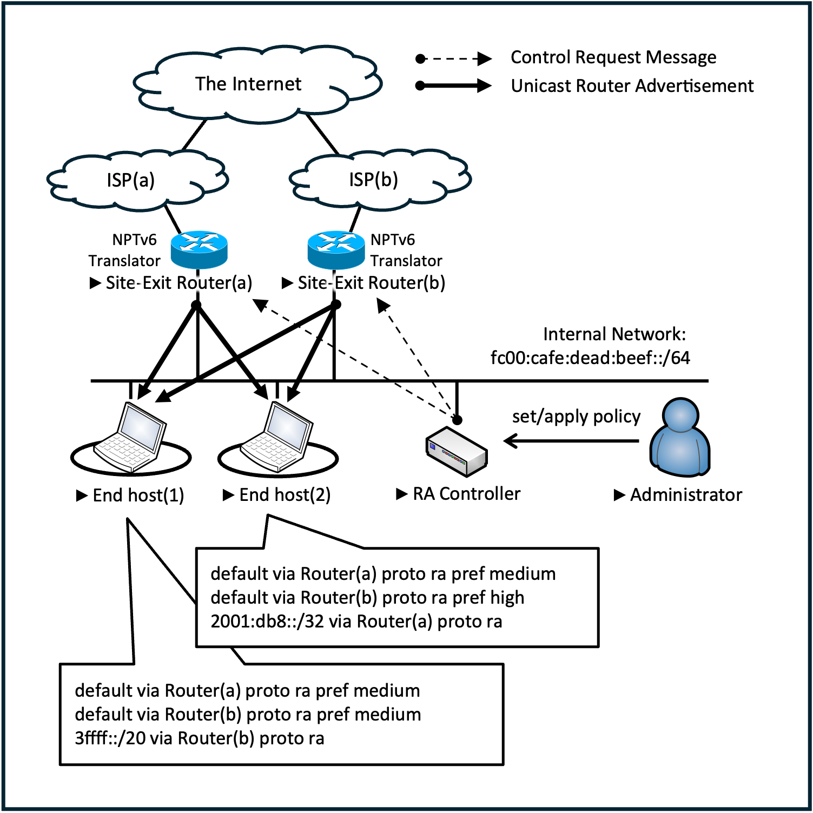

# Polaris

A Host-Based Policy Routing Framework for IPv6 Site Multihoming
without End Host Modifications.

Polaris enables a network administrator to direct traffic from individual
hosts (or host groups) to specific upstream ISPs in an IPv6 site multihoming
environment **without touching the end-host configuration**.  It does so by
combining [NPTv6](https://www.rfc-editor.org/rfc/rfc6296) with **dynamically
controlled unicast Router Advertisements** (RFC 4191).

[English](README.md) / [日本語](README_ja.md)

## Why Polaris?

In conventional IPv6 site multihoming, the upstream ISP is determined by
**source-address selection** at the end host.

Polaris **shifts ISP selection from source-address selection to first-hop
router selection**.  All hosts share a single IPv6 prefix (translated by
NPTv6 at each site-exit router), and the framework controls *which*
site-exit router each host uses by sending **per-host unicast RAs** with
appropriate DRP/RIO values.

> DRP: Default Router Preference
> RIO: Route Information Option

## Architecture



The administrator defines policies via the RA Controller's web UI.  The
controller compiles each policy into a per-router gRPC `InterfaceConfig`
and pushes it to the corresponding `gora` daemon.  `gora` then transmits
unicast RAs to the targeted hosts, modifying their default gateway
(`DRP=high`) or installing route information (`RIO`).

## Repository layout

| Path | Role |
|------|------|
| [`agent/`](agent/) | Site-exit router agent (`gora` daemon, NPTv6 setup, systemd unit) |
| [`agent/go-ra/`](agent/go-ra/) | go-ra source — git submodule, forked from [YutaroHayakawa/go-ra](https://github.com/YutaroHayakawa/go-ra) |
| [`controller/`](controller/) | RA Controller — Go backend, React/Vite frontend, neighbor & endpoint collector modules |
| [`laboratory/`](laboratory/) | Self-contained Docker Compose lab (3 routers, 10 hosts, controller, web server) |
| [`experiments/`](experiments/) | Scripts that build the experiment site (2 routers, 2 ISPs, 200 hosts) and run the experiments of the paper |
| [`docs/design.md`](docs/design.md) | Design of the controller: component boundaries, contracts, policy lifecycle, start-up |

Each subdirectory has its own README — see those for build & deployment
details.

## Three ways to run Polaris

### 1. Docker lab

A complete reproducible environment with three routers (one ISP each), ten
hosts, the controller, and a web server that plays the Internet.

```bash
git clone --recurse-submodules <this-repo>
cd polaris/laboratory
./lab up        # build, start, wait until ready
./lab demo      # apply every scenario and verify routing tables and egress ISPs
# open http://localhost:3000
```

See [`laboratory/README.md`](laboratory/README.md) for the scenarios, what
the verification checks, and the note on kernels without RIO support.

### 2. Standalone controller (for testing against real routers)

Run the controller on a management host, with `gora` agents already deployed
on your routers. Edit `controller/param.yaml`, then:

```bash
cd controller
docker compose up -d        # web UI and API on http://<this host>:8080
# or, without Docker:
./server.sh
```

See [`controller/README.md`](controller/README.md) for systemd deployment,
parameter file format, and module configuration.

### 3. Production agent (per router)

Deploy the agent on each site-exit router — configures NPTv6, NDP proxy,
sysctls, and installs `gora` as a systemd service.

```bash
cd agent
git submodule update --init
cp setup.conf.example setup.conf     # then edit: WAN_IF, WAN_PREFIX, LAN_PREFIX, LAN_IF, ...
sudo ./setup.sh --print-config      # shows what would be written; changes nothing
sudo ./setup.sh
```

See [`agent/README.md`](agent/README.md) for the operational guide.

## Key concepts

| Term | Meaning |
|------|---------|
| **Rule** | A mapping `(destination prefixes) → (site-exit router)` |
| **Group** | A named set of host link-local addresses |
| **Policy** | A group ↔ rules association — applied to all member hosts |
| **DRP** | Default Router Preference (RFC 4191) — `high` makes a router the preferred default gateway |
| **RIO** | Route Information Option (RFC 4191) — installs a specific-prefix route |
| **NPTv6** | One-to-one prefix translation (RFC 6296) — preserves host privacy and avoids ingress filtering |

### Two RA source addresses per router

A host keeps one default-router entry per RA source address and overwrites
its preference and lifetime with every RA from that address. Polaris
therefore gives each site-exit router two link-local addresses on the
internal interface:

- the **baseline address** sends the ordinary RA (prefix, preference medium)
  to all hosts;
- the **policy address** sends only the policy RAs, unicast, to the hosts of
  a policy.

The two never overwrite each other, and withdrawing a policy (zero lifetimes
from the policy address) returns the host to the baseline at once. Set the
policy address per router in the controller (`policy_source_address`); see
[`agent/README.md`](agent/README.md) for how to assign it on a router.

### Policy-to-RA compilation

The controller compiles the policy as in Algorithm 1 of the paper:

1. For every pair of a router *n* and a host *h*, merge all rules that apply
   to *h* and designate *n*. A prefix other than `::/0` becomes a `RIO`;
   `::/0` sets `preference = high` (DRP), making *n* the preferred default
   router of *h*.
2. Group the hosts that receive identical content from the same router into
   one `InterfaceConfig`. A host receives at most one policy RA per router.

A policy RA without `::/0` has Router Lifetime 0: it only carries routes.

### Applying a policy

`POST /api/policy/apply` compares the compiled policy with the
configurations each router is running and applies the difference in two
phases, across all routers:

1. **Make** — add and update configurations; the new RAs are sent
   immediately.
2. **Break** — delete obsolete configurations and send a withdrawal RA
   (zero lifetimes) to every host that lost a route or its preferred default
   router.

A host that moves from one router to another therefore holds both for a
moment, never neither. If the make phase fails on a reachable router, the
break phase is skipped and the old policy stays in force. Because the
running state is read from the routers, the controller keeps no apply
history: deleting a rule and applying again removes it from the routers.
`POST /api/policy/apply?dry_run=1` reports the changes without making them.

The implementation lives in
[`controller/backend/internal/engine/`](controller/backend/internal/engine/):
`compile.go` (Algorithm 1), `reconcile.go` (difference and withdrawals),
`engine.go` (two-phase apply).
