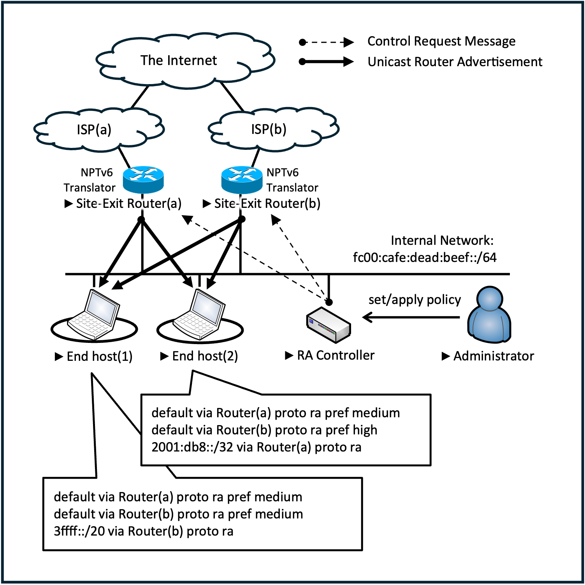

# Polaris

エンドホストを変更しない、IPv6 サイトマルチホーミングのためのホストベースの
ポリシールーティングフレームワーク

ネットワーク管理者が、IPv6 サイトマルチホーミング環境において、
**エンドホストの設定を一切変更することなく**、各ホスト（あるいはホストグループ）の
トラフィックを特定の上位 ISP に振り分けることを可能にします。これは
[NPTv6](https://www.rfc-editor.org/rfc/rfc6296) と、
**動的に制御されるユニキャスト Router Advertisement** (RFC 4191) を組み合わせて
実現されます。

[English](README.md) / [日本語](README_ja.md)

## なぜ Polaris か

従来の IPv6 サイトマルチホーミングは、エンドホスト側での
**送信元アドレス選択**に依存して、使用する上位 ISP が決定されます。

Polaris は **ISP 選択の起点を「送信元アドレス選択」から「ファーストホップ
ルータ選択」へシフト** します。すべてのホストは単一の IPv6 プレフィクスを共有し
（各サイト出口ルータが NPTv6 で変換）、フレームワークは適切な DRP/RIO 値を
持つ **ホスト単位のユニキャスト RA** を送信することで、各ホストが使用する
サイト出口ルータを制御します。

> DRP: Default Router Preference
> RIO: Route Information Option

## アーキテクチャ



管理者は RA Controller の Web UI でポリシーを定義します。コントローラは
各ポリシーを各ルータ向けの gRPC `InterfaceConfig` にコンパイルし、対応する
`gora` デーモンへ push します。`gora` は対象ホストへユニキャスト RA を
送信し、デフォルトゲートウェイ（`DRP=high`）または経路情報（`RIO`）を
更新します。

## リポジトリ構成

| パス | 役割 |
|------|------|
| [`agent/`](agent/) | サイト出口ルータ用エージェント（`gora` デーモン、NPTv6 セットアップ、systemd ユニット）|
| [`agent/go-ra/`](agent/go-ra/) | go-ra ソース — git submodule、[YutaroHayakawa/go-ra](https://github.com/YutaroHayakawa/go-ra) からのフォーク |
| [`controller/`](controller/) | RA Controller — Go バックエンド、React/Vite フロントエンド、Neighbor / Endpoint Collector モジュール |
| [`laboratory/`](laboratory/) | 自己完結型 Docker Compose ラボ（ルータ 3 台、ホスト 10 台、コントローラ、Web サーバ）|
| [`experiments/`](experiments/) | 実験環境（ルータ 2 台、ISP 2 つ、ホスト 200 台）を構築し、論文の実験を実施するスクリプト |
| [`docs/design_ja.md`](docs/design_ja.md) | controller の設計: 部品の境界、契約、ポリシーのライフサイクル、起動 |

各サブディレクトリには専用の README があります。ビルド・デプロイの詳細は
そちらを参照してください。

## Polaris の動作モード

### 1. Docker lab

ルータ 3 台（それぞれ別の ISP）、ホスト 10 台、コントローラ、インターネット役の
Web サーバから成る、再現可能な環境です。

```bash
git clone --recurse-submodules <this-repo>
cd polaris/laboratory
./lab up        # ビルドして起動し、準備完了まで待つ
./lab demo      # 全シナリオを適用し、経路表と出口 ISP を検証する
# http://localhost:3000 を開く
```

シナリオ、検証の内容、RIO 非対応カーネルでの注意は
[`laboratory/README_ja.md`](laboratory/README_ja.md) を参照してください。

### 2. コントローラ単独実行（実機ルータでのテスト用）

管理ホスト上でコントローラを起動し、事前にデプロイ済みの `gora` エージェントと連携させます。
`controller/param.yaml` を編集してから、次を実行します。

```bash
cd controller
docker compose up -d        # Web UI と API: http://<このホスト>:8080
# Docker を使わない場合:
./server.sh
```

systemd デプロイ、パラメータファイル形式、モジュール設定については
[`controller/README_ja.md`](controller/README_ja.md) を参照してください。

### 3. 本番用ルータ・エージェント

各サイト出口ルータにエージェントをデプロイします。NPTv6 / NDP プロキシ /
sysctl の設定および `gora` の systemd サービス化を自動で行います。

```bash
cd agent
git submodule update --init
sudo WAN_PREFIX=2001:db8:wan::/64  \
     LAN_PREFIX=fc00:cafe::/64     \
     WAN_IF=eth0  ./setup.sh
```

運用ガイドは [`agent/README_ja.md`](agent/README_ja.md) を参照してください。

## 主要な概念

| 用語 | 意味 |
|------|------|
| **Rule** | `(宛先プレフィクス集合) → (サイト出口ルータ)` のマッピング |
| **Group** | 複数ホストの link-local アドレスから成る名前付き集合 |
| **Policy** | Group と Rule の関連付け — グループ所属ホスト全員に適用される |
| **DRP** | Default Router Preference (RFC 4191) — `high` でそのルータが優先デフォルトゲートウェイになる |
| **RIO** | Route Information Option (RFC 4191) — 特定プレフィクス向けの経路をインストール |
| **NPTv6** | プレフィクス 1 対 1 変換 (RFC 6296) — ホストプライバシーを保ち、Ingress filter を回避 |

### ルータごとに 2 つの RA 送信元アドレス

ホストは RA の送信元アドレスごとにデフォルトルータのエントリを 1 つ持ち、
そのアドレスから RA を受けるたびに優先度と lifetime を上書きします。
そこで Polaris は、各サイト出口ルータの内部インターフェースに
リンクローカルアドレスを 2 つ持たせます。

- **ベースライン用アドレス**: 通常の RA（プレフィクス、優先度 medium）を全ホストへ送る。
- **ポリシー用アドレス**: ポリシー RA だけを、対象ホストへユニキャストで送る。

両者は互いを上書きしません。ポリシーを取り下げる（ポリシー用アドレスから
lifetime 0 を送る）と、ホストはすぐにベースラインへ戻ります。
ポリシー用アドレスはコントローラでルータごとに設定します（`policy_source_address`）。
ルータへの割り当て方法は [`agent/README_ja.md`](agent/README_ja.md) を参照してください。

### Policy から RA への変換

コントローラは、論文の Algorithm 1 のとおりにポリシーをコンパイルします。

1. ルータ *n* とホスト *h* の組ごとに、*h* に適用され *n* を指定するルールを
   すべて統合する。`::/0` 以外のプレフィクスは `RIO` になる。`::/0` は
   `preference = high`（DRP）を設定し、*n* を *h* の優先デフォルトルータにする。
2. 同じルータから同じ内容を受け取るホストを、1 つの `InterfaceConfig` にまとめる。
   ホストが受け取るポリシー RA は、ルータごとに最大 1 通になる。

`::/0` を含まないポリシー RA の Router Lifetime は 0 で、経路だけを運びます。

### ポリシーの適用

`POST /api/policy/apply` は、コンパイル結果と各ルータで動いている設定を比較し、
差分を全ルータに対して 2 段階で適用します。

1. **Make**: 設定を追加・更新する。新しい RA はすぐに送られる。
2. **Break**: 不要になった設定を削除し、経路または優先デフォルトルータを失う
   ホストへ取り下げ RA（lifetime 0）を送る。

このため、あるルータから別のルータへ移るホストは、一時的に両方を持つことはあっても、
どちらも持たない状態にはなりません。到達可能なルータで Make が失敗した場合、
Break は実行せず、古いポリシーをそのまま残します。動作中の状態はルータから
読み取るので、コントローラは適用履歴を持ちません。ルールを削除して再度適用すれば、
ルータからも消えます。`POST /api/policy/apply?dry_run=1` は、変更せずに差分だけを返します。

実装は
[`controller/backend/internal/engine/`](controller/backend/internal/engine/) にあります:
`compile.go`（Algorithm 1）、`reconcile.go`（差分と取り下げ）、`engine.go`（2 段階の適用）。
