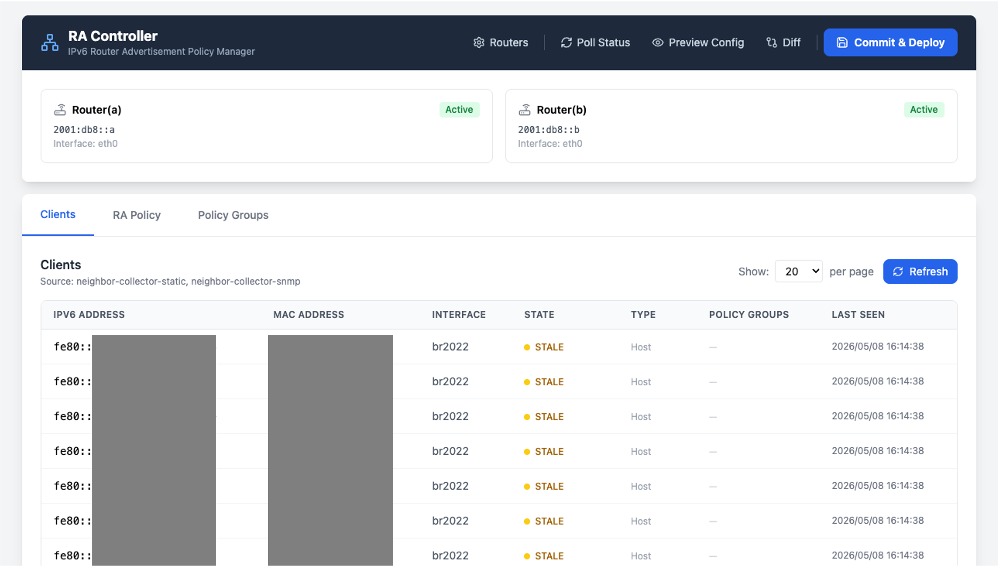
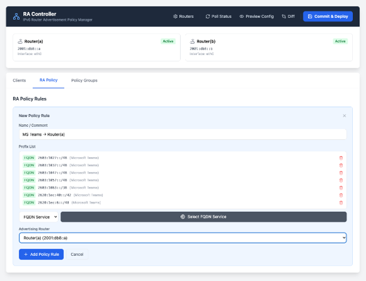
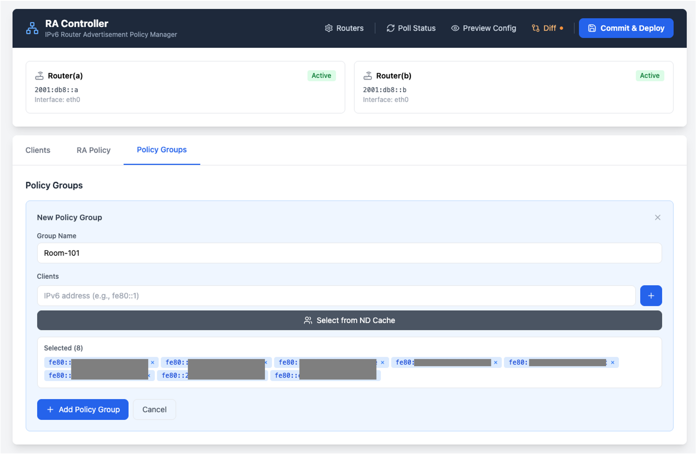
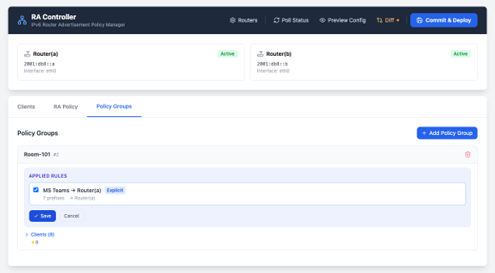
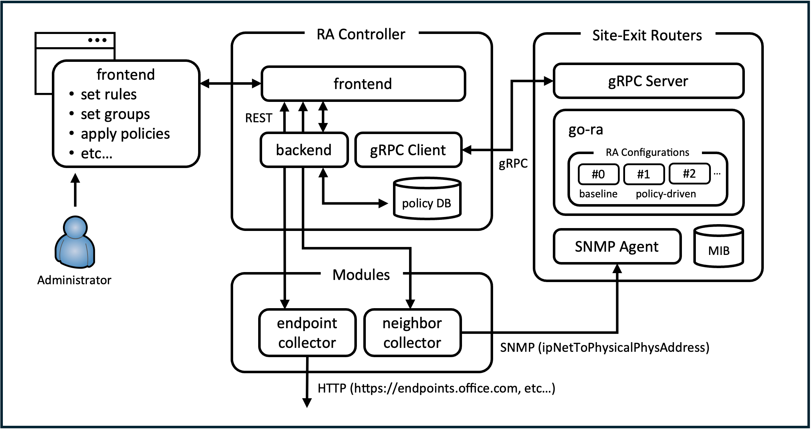

# RA Controller

A web-based management UI and backend for the [go-ra (forked)](https://github.com/y-kzm/go-ra) IPv6 Router Advertisement daemon.
Configure routers, define routing rules, organise hosts into groups, and push the resulting policy to every router's go-ra agent over gRPC — all from a browser.

## Screenshots

| Clients | RA Policy Rules |
|---------|-----------------|
|  |  |

| Create policy group | Assign rules |
|---------------------|--------------|
|  |  |

## Architecture



### Components

| Directory | Role |
|-----------|------|
| `backend/` | Go HTTP server — stores config in SQLite and pushes policy to routers |
| `frontend/` | Vite + React + TypeScript management UI |
| `modules/neighbor-collector-snmp/` | Polls routers via SNMP to discover IPv6 neighbors |
| `modules/neighbor-collector-static/` | Serves a static list of neighbors |
| `modules/endpoint-collector-static/` | Serves a static list of FQDN/IP endpoints |
| `modules/endpoint-collector-ms365/` | Fetches Microsoft 365 endpoints from the Microsoft API |

### Key concepts

- **Router**: A site-exit router running a go-ra agent, with its RA parameters. An *inactive* router is left out of the policy: its policy RAs are withdrawn at the next apply.
- **Rule**: Destination prefixes — literal IPv6 prefixes, or a *service* whose prefixes are looked up at every apply — and the router they go through.
- **Group**: A named set of hosts, identified by their link-local addresses, and the rules that apply to them.
- **Neighbor**: A host discovered on the site link. Neighbors are a pick list for group members; a group stores addresses, not references.
- **Draft, plan, apply**: Editing changes only the database (the draft). **Plan** shows, computed by the backend from the routers' real state, what an apply would change. **Apply** brings the routers to the draft: new RAs first, withdrawals after. The applied policy is re-applied periodically, which restores a router after a restart.

The design — component boundaries, the HTTP contracts between them, the policy lifecycle and the start-up — is in [`../docs/design.md`](../docs/design.md).

## Quick start

With Docker (nothing else to install):

```bash
docker compose up -d          # web UI and API: http://<this host>:8080
docker compose logs -f        # every component, labelled
docker compose down           # stop (add -v to delete the database)
```

Without Docker (needs Go, Node.js for the first build, and Python 3 with PyYAML):

```bash
./server.sh                   # builds what is missing, then starts everything
./server.sh dev               # the same, plus the Vite development server for frontend work
./server.sh build             # build only
```

Both start the modules enabled in `param.yaml` and the backend, which serves the
web UI and the API on one port. The container uses the host's network (Linux), so
that the backend reaches the routers' agents over IPv6.

## Configuration

`param.yaml` is the only file to edit; after a change, `docker compose restart`
(or restart `server.sh`).

```yaml
backend:
  port: 8080                  # web UI and API
  listen_host: ""             # "" = every interface
  data_dir: ./data            # database and module caches
  fetch_interval: 10          # seconds between fetches from the neighbor sources
  reconcile_interval: 60      # seconds between re-applies of the applied policy; 0 = off
  cors_origins: []            # other origins allowed to call the API

modules:                      # each is a separate process the backend queries over HTTP
  neighbor_collector_snmp:    # hosts, from the routers' neighbor caches (SNMP)
    enabled: false
    port: 8084
    poll_interval: 30
    stale_polls: 3            # a router that fails this many polls loses its hosts
    snmp_targets:
      - host: "router-a.example.com"
        community: "public"
        ifname: "eth1"        # only neighbors on this interface (the site link)
        self_ll: "fe80::1"    # the router's own address on that link
  neighbor_collector_static:  # a fixed list of hosts
    enabled: true
    port: 8083
    neighbors: []
  endpoint_collector_ms365:   # prefixes of Microsoft 365 services
    enabled: false
    port: 8085
    instance: Worldwide       # Worldwide | China | USGovDoD | USGovGCCHigh
    refresh_interval: 3600
  endpoint_collector_static:  # a fixed list of services
    enabled: true
    port: 8082
    services: []
```

Modules listen on `127.0.0.1` unless `listen_host` is set for them. The backend
has no authentication: make its port reachable from the management network only
(see the security assumptions in the design document).

## REST API summary

Mounted under `/api`. Errors are `{"error": "<message>"}` with a 4xx or 5xx status.

| Method | Path | Description |
|--------|------|-------------|
| GET    | `/health` | Liveness |
| GET    | `/routers` | List registered routers |
| POST   | `/routers` | Register a router |
| PUT    | `/routers/{id}` | Edit a router (also its status: `active` / `inactive`) |
| DELETE | `/routers/{id}` | Decommission: withdraw the router's policy RAs, then remove it. `409` while a rule uses it or if it cannot be reached (`?force=1` removes it anyway) |
| GET    | `/routers/status`, `/routers/{id}/status` | Reachability and TX counters (gRPC `GetStatus`) |
| GET    | `/routers/{id}/interfaces` | The RA configurations a router is running (gRPC `ListInterfaces`) |
| GET, POST | `/rules` | List, create (`{nexthop, entries: [{type: "ipv6", value: <prefix>} \| {type: "service", value: <name>}]}`) |
| PUT, DELETE | `/rules/{id}` | Edit; delete (also removes the rule from every group) |
| GET, POST | `/groups` | List, create (`{name, members: [<link-local>...], rules: [<id>...]}`) |
| PUT    | `/groups/{id}`, `/groups/{id}/rules` | Replace a group; replace only its rules |
| DELETE | `/groups/{id}` | Delete a group |
| GET    | `/neighbors` | Hosts seen by the neighbor sources |
| POST   | `/neighbors/refresh` | Ask every source to refresh now |
| GET    | `/fqdn/services`, `/fqdn/services/{name}/endpoints` | Services of the endpoint sources and their prefixes |
| GET    | `/sources` | Health of every neighbor and endpoint source |
| GET    | `/policy/plan` | What an apply would do: per router, the control request messages and the changes; warnings; `pending` |
| POST   | `/policy/apply` | Compile (Algorithm 1) and reconcile every router in two phases (advertise new, withdraw old). `?dry_run=1` only reports the changes |

#### Project structure

```
server.sh                     starts everything from param.yaml
param.yaml                    the configuration
Dockerfile, docker-compose.yaml
backend/
  cmd/server/                 entry point (configured by environment variables)
  internal/api/               REST API, validation, plan / apply / periodic reconcile
  internal/engine/            Algorithm 1 (compile.go), diff (reconcile.go), two-phase apply (engine.go)
  internal/store/             SQLite: routers, rules, groups, applied policy, service cache
  internal/neighbor/          client of the neighbor sources
  internal/fqdn/              client of the endpoint sources
  internal/gora/              gRPC client of the agents
frontend/src/                 the web UI; it renders the API and holds no policy logic
modules/                      neighbor and endpoint sources (one process each)
```

## Neighbor refresh

The **Refresh** button in the Clients tab triggers a full end-to-end poll — not just a cache read:

1. Backend calls `POST /api/neighbors/refresh` on every collector **in parallel**
2. Each collector runs an immediate SNMP walk
3. Backend fetches the updated results and writes them to the DB
4. The UI shows the latest data

The button is disabled for 10 seconds after each refresh to prevent SNMP flooding.

Background polling (`fetch_interval` / `poll_interval`) continues independently.

## Systemd deployment

### Prerequisites

- Linux with systemd
- Go and Node.js, to build once (`./server.sh build`, run as a user that may write to the installation directory); the service itself then needs neither
- Python 3 + PyYAML (`apt install python3-yaml`)

With Docker, none of this is needed: see [Quick start](#quick-start).

### Installation

**1. Create a dedicated system user**

```bash
sudo useradd -r -s /sbin/nologin -d /opt/ra-controller ra-controller
```

**2. Deploy the application**

```bash
sudo cp -r /path/to/ra-controller /opt/ra-controller
sudo chown -R ra-controller:ra-controller /opt/ra-controller
sudo chmod +x /opt/ra-controller/server.sh
```

**3. Edit param.yaml**

```bash
sudo -u ra-controller nano /opt/ra-controller/param.yaml
```

Configure `snmp_targets`, ports, and any other settings for your environment.

**4. (Optional) Create an environment override file**

```bash
sudo mkdir -p /etc/ra-controller
sudo cp /opt/ra-controller/systemd/env.example /etc/ra-controller/env
sudo nano /etc/ra-controller/env
```

Uncomment and set any values that differ from `param.yaml` defaults.

**5. (Optional) Prepare a log directory**

Only needed if you want file-based logs in addition to journald.

```bash
sudo mkdir -p /var/log/ra-controller
sudo chown ra-controller:ra-controller /var/log/ra-controller
```

Then set `LOG_DIR=/var/log/ra-controller` in `/etc/ra-controller/env`.

**6. Install and start the service**

```bash
sudo cp /opt/ra-controller/systemd/ra-controller.service /etc/systemd/system/
sudo systemctl daemon-reload
sudo systemctl enable --now ra-controller
```

### Day-to-day operations

```bash
# Status
sudo systemctl status ra-controller

# Start / stop / restart
sudo systemctl start   ra-controller
sudo systemctl stop    ra-controller
sudo systemctl restart ra-controller

# Live log stream
sudo journalctl -u ra-controller -f

# Logs since last boot
sudo journalctl -u ra-controller -b

# Filter by component (grep on the bracketed label)
sudo journalctl -u ra-controller -g '\[backend\]'
sudo journalctl -u ra-controller -g '\[neighbor_collector_snmp\]'

# Last 100 lines
sudo journalctl -u ra-controller -n 100
```

### Updating

```bash
# 1. Deploy new files
sudo rsync -a --chown=ra-controller:ra-controller /path/to/new-version/ /opt/ra-controller/

# 2. Restart the service (server.sh rebuilds Go binaries on start)
sudo systemctl restart ra-controller
```

### Changing the installation path

The service file defaults to `/opt/ra-controller`.  To use a different path, edit before installing:

```bash
sudo sed -i 's|/opt/ra-controller|/your/path|g' \
  /opt/ra-controller/systemd/ra-controller.service
```

### Log format

Each line from every component is prefixed with a timestamp and a bracketed component name:

```
YYYY-MM-DD HH:MM:SS [component-name] original log message
```

Example:

```
2026-05-08 15:32:01 [backend] starting go-ra client backend server on port 8080
2026-05-08 15:32:04 [neighbor_collector_snmp] snmp: refreshed 12 neighbor(s) from 2 target(s)
```

Under systemd, journald adds its own timestamp, so each line carries two timestamps — the outer one from journald and the inner one from `server.sh`.  The inner timestamp reflects when the component actually emitted the message.
