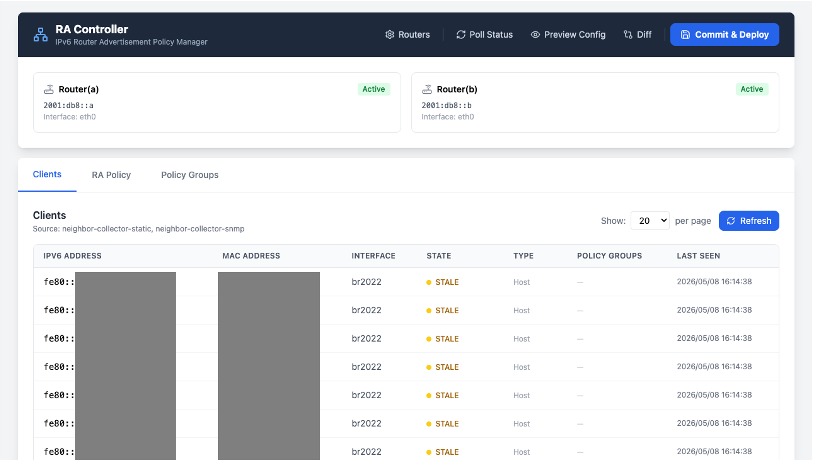
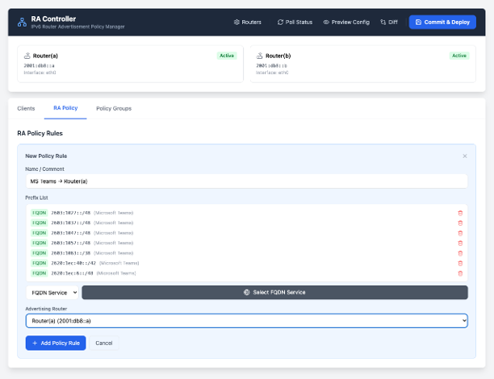
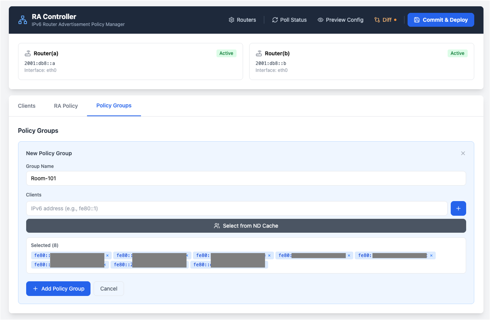
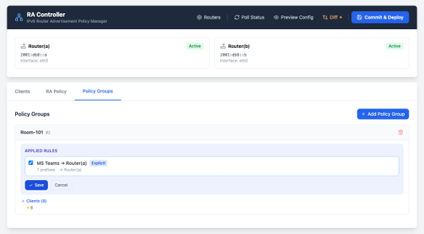
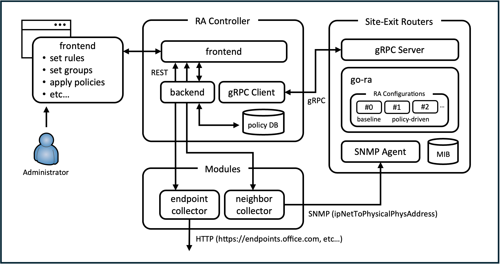

# RA Controller

IPv6 ルータ広告デーモン [go-ra (fork版)](https://github.com/y-kzm/go-ra) を管理するための Web UI + バックエンドです。
ブラウザからルータの設定・ルーティングルール・ホストグループを管理し、ポリシーを各ルータ上の go-ra エージェントへ gRPC で一括適用できます。

## スクリーンショット

| クライアント一覧 | RA ポリシールール |
|----------------|----------------|
|  |  |


| ポリシーグループ作成 | ルール割り当て |
|-------------------|-------------|
|  |  |

## アーキテクチャ



### コンポーネント

| ディレクトリ | 役割 |
|-------------|------|
| `backend/` | Go HTTP サーバ。設定を SQLite に保存し、ポリシーをルータへ push する |
| `frontend/` | Vite + React + TypeScript の管理 UI |
| `modules/neighbor-collector-snmp/` | SNMP でルータから IPv6 ネイバーを収集する |
| `modules/neighbor-collector-static/` | 静的なネイバーリストを返す |
| `modules/endpoint-collector-static/` | 静的な FQDN/IP エンドポイントリストを返す |
| `modules/endpoint-collector-ms365/` | Microsoft API から Microsoft 365 のエンドポイントを取得する |

### 主要な概念

- **Router**: go-ra agent が動くサイト出口ルータと、その RA パラメータ。*inactive* にしたルータはポリシーから外れ、次の適用でポリシー RA が取り下げられます。
- **Rule**: 宛先プレフィクスと、その経由ルータ。プレフィクスは IPv6 プレフィクスの直接指定か、適用のたびに解決する*サービス*で指定します。
- **Group**: ホスト（リンクローカルアドレスで識別）の集合と、それに適用するルール。
- **Neighbor**: サイトのリンク上で見つかったホスト。グループのメンバーを選ぶための一覧です。グループが保存するのはアドレスで、近隣への参照ではありません。
- **下書き・Plan・Apply**: 編集はデータベース（下書き）だけを変更します。**Plan** は、適用すると何が変わるかを、backend がルータの実際の状態から計算して示します。**Apply** はルータを下書きの状態にします（新しい RA が先、取り下げが後）。適用済みのポリシーは定期的に再適用され、再起動したルータにも戻ります。

部品の境界、部品間の HTTP の契約、ポリシーのライフサイクル、起動方法の設計は
[`../docs/design_ja.md`](../docs/design_ja.md) にあります。

## クイックスタート

Docker を使う場合（他に必要なものはありません）:

```bash
docker compose up -d          # Web UI と API: http://<このホスト>:8080
docker compose logs -f        # 全コンポーネントのログ（ラベル付き）
docker compose down           # 停止（-v を付けるとデータベースも削除）
```

Docker を使わない場合（Go、初回ビルド用の Node.js、Python 3 と PyYAML が必要）:

```bash
./server.sh                   # 足りないものをビルドして、すべて起動する
./server.sh dev               # 上に加えて、frontend 開発用の Vite 開発サーバも起動する
./server.sh build             # ビルドだけ行う
```

どちらも、`param.yaml` で有効にした module と backend を起動します。backend は Web UI と
API を 1 つのポートで提供します。コンテナはホストのネットワークを使います（Linux）。
backend が IPv6 でルータの agent に届くようにするためです。

## 設定

編集するのは `param.yaml` だけです。変更後は `docker compose restart`
（または `server.sh` の再起動）で反映します。

```yaml
backend:
  port: 8080                  # Web UI と API
  listen_host: ""             # "" = 全インターフェース
  data_dir: ./data            # データベースと module のキャッシュ
  fetch_interval: 10          # neighbor source から取得する間隔（秒）
  reconcile_interval: 60      # 適用済みポリシーを再適用する間隔（秒）。0 = 無効
  cors_origins: []            # API を呼べる別オリジン

modules:                      # それぞれ別プロセスで、backend が HTTP で問い合わせる
  neighbor_collector_snmp:    # ルータの近隣キャッシュからホストを取得（SNMP）
    enabled: false
    port: 8084
    poll_interval: 30
    stale_polls: 3            # この回数連続で失敗したルータのホストを落とす
    snmp_targets:
      - host: "router-a.example.com"
        community: "public"
        ifname: "eth1"        # このインターフェース（サイトのリンク）の近隣だけ
        self_ll: "fe80::1"    # そのリンク上のルータ自身のアドレス
  neighbor_collector_static:  # 固定のホスト一覧
    enabled: true
    port: 8083
    neighbors: []
  endpoint_collector_ms365:   # Microsoft 365 のサービスのプレフィクス
    enabled: false
    port: 8085
    instance: Worldwide       # Worldwide | China | USGovDoD | USGovGCCHigh
    refresh_interval: 3600
  endpoint_collector_static:  # 固定のサービス一覧
    enabled: true
    port: 8082
    services: []
```

module は、`listen_host` を指定しない限り `127.0.0.1` で待ち受けます。backend には認証が
ありません。ポートには管理ネットワークからだけ到達できるようにしてください
（設計文書の「セキュリティ上の前提」を参照）。

## REST API 概要

`/api` の下にあります。エラーは `{"error": "<メッセージ>"}` と 4xx / 5xx のステータスで返ります。

| メソッド | パス | 説明 |
|----------|------|------|
| GET    | `/health` | 生存確認 |
| GET    | `/routers` | 登録済みルータの一覧 |
| POST   | `/routers` | ルータを登録 |
| PUT    | `/routers/{id}` | ルータを編集（状態 `active` / `inactive` も） |
| DELETE | `/routers/{id}` | 撤去: ルータのポリシー RA を取り下げてから削除する。ルールが使用中、または到達できない場合は `409`（`?force=1` で強制削除） |
| GET    | `/routers/status`、`/routers/{id}/status` | 到達性と送信カウンタ（gRPC `GetStatus`） |
| GET    | `/routers/{id}/interfaces` | ルータで動いている RA 設定（gRPC `ListInterfaces`） |
| GET、POST | `/rules` | 一覧、作成（`{nexthop, entries: [{type: "ipv6", value: <prefix>} \| {type: "service", value: <name>}]}`） |
| PUT、DELETE | `/rules/{id}` | 編集、削除（全グループからも外れる） |
| GET、POST | `/groups` | 一覧、作成（`{name, members: [<link-local>...], rules: [<id>...]}`） |
| PUT    | `/groups/{id}`、`/groups/{id}/rules` | グループ全体の置き換え、ルールだけの置き換え |
| DELETE | `/groups/{id}` | グループを削除 |
| GET    | `/neighbors` | neighbor source が見つけたホスト |
| POST   | `/neighbors/refresh` | 全情報源に即時更新を要求 |
| GET    | `/fqdn/services`、`/fqdn/services/{name}/endpoints` | endpoint source のサービスとそのプレフィクス |
| GET    | `/sources` | neighbor / endpoint の各情報源の状態 |
| GET    | `/policy/plan` | 適用すると何が起きるか: ルータごとの制御要求メッセージと変更、警告、`pending` |
| POST   | `/policy/apply` | コンパイル（Algorithm 1）し、全ルータを 2 段階で反映（新しい広告 → 古い広告の取り下げ）。`?dry_run=1` は変更の報告のみ |

#### プロジェクト構成

```
server.sh                     param.yaml からすべてを起動する
param.yaml                    設定
Dockerfile, docker-compose.yaml
backend/
  cmd/server/                 エントリポイント（環境変数で設定）
  internal/api/               REST API、検証、plan / apply / 定期再適用
  internal/engine/            Algorithm 1（compile.go）、差分（reconcile.go）、2 段階適用（engine.go）
  internal/store/             SQLite: ルータ、ルール、グループ、適用済みポリシー、サービスのキャッシュ
  internal/neighbor/          neighbor source のクライアント
  internal/fqdn/              endpoint source のクライアント
  internal/gora/              agent の gRPC クライアント
frontend/src/                 Web UI。API を表示するだけで、ポリシーのロジックは持たない
modules/                      neighbor / endpoint の情報源（それぞれ 1 プロセス）
```

## ネイバーリフレッシュ

Clients タブの **Refresh** ボタンはキャッシュを読むだけでなく、エンドツーエンドのポーリングを行います：

1. バックエンドが全コレクタへ `POST /api/neighbors/refresh` を**並列**で送信
2. 各コレクタが即時 SNMP ウォークを実行
3. バックエンドが更新済みの結果を取得して DB に書き込み
4. UI に最新データを反映

SNMP フラッディングを防ぐため、リフレッシュ後 10 秒間はボタンを無効化します。

バックグラウンドポーリング（`fetch_interval` / `poll_interval`）は独立して継続します。

## systemd デプロイ

### 前提条件

- systemd を使用する Linux
- Go と Node.js。最初に 1 回ビルドするために使います（`./server.sh build`。インストール先に書き込めるユーザーで実行）。サービス自体の実行には不要です
- Python 3 + PyYAML（`apt install python3-yaml`）

Docker を使う場合はどれも不要です。[クイックスタート](#クイックスタート)を参照してください。

### インストール手順

**1. 専用システムユーザの作成**

```bash
sudo useradd -r -s /sbin/nologin -d /opt/ra-controller ra-controller
```

**2. アプリケーションのデプロイ**

```bash
sudo cp -r /path/to/ra-controller /opt/ra-controller
sudo chown -R ra-controller:ra-controller /opt/ra-controller
sudo chmod +x /opt/ra-controller/server.sh
```

**3. param.yaml の編集**

```bash
sudo -u ra-controller nano /opt/ra-controller/param.yaml
```

`snmp_targets` やポート番号など、環境に合わせた設定を行います。

**4. （省略可）環境変数オーバーライドファイルの作成**

```bash
sudo mkdir -p /etc/ra-controller
sudo cp /opt/ra-controller/systemd/env.example /etc/ra-controller/env
sudo nano /etc/ra-controller/env
```

`param.yaml` のデフォルト値と異なる値をアンコメントして設定します。

**5. （省略可）ログディレクトリの準備**

journald に加えてファイルへのログ出力が必要な場合のみ設定します。

```bash
sudo mkdir -p /var/log/ra-controller
sudo chown ra-controller:ra-controller /var/log/ra-controller
```

その後、`/etc/ra-controller/env` に `LOG_DIR=/var/log/ra-controller` を設定します。

**6. サービスのインストールと起動**

```bash
sudo cp /opt/ra-controller/systemd/ra-controller.service /etc/systemd/system/
sudo systemctl daemon-reload
sudo systemctl enable --now ra-controller
```

### 日常的な操作

```bash
# 状態確認
sudo systemctl status ra-controller

# 起動 / 停止 / 再起動
sudo systemctl start   ra-controller
sudo systemctl stop    ra-controller
sudo systemctl restart ra-controller

# ライブログストリーム
sudo journalctl -u ra-controller -f

# 最後の起動以降のログ
sudo journalctl -u ra-controller -b

# コンポーネントでフィルタ（括弧内のラベルで grep）
sudo journalctl -u ra-controller -g '\[backend\]'
sudo journalctl -u ra-controller -g '\[neighbor_collector_snmp\]'

# 最新 100 行
sudo journalctl -u ra-controller -n 100
```

### アップデート

```bash
# 1. 新しいファイルをデプロイ
sudo rsync -a --chown=ra-controller:ra-controller /path/to/new-version/ /opt/ra-controller/

# 2. サービスを再起動（server.sh が起動時に Go バイナリを再ビルドする）
sudo systemctl restart ra-controller
```

### インストールパスの変更

サービスファイルはデフォルトで `/opt/ra-controller` を使用します。別のパスに変更する場合は、インストール前にサービスファイルを編集します：

```bash
sudo sed -i 's|/opt/ra-controller|/your/path|g' \
  /opt/ra-controller/systemd/ra-controller.service
```

### ログフォーマット

各コンポーネントの出力行は、タイムスタンプとブラケット付きコンポーネント名でプレフィックスされます：

```
YYYY-MM-DD HH:MM:SS [component-name] original log message
```

例：

```
2026-05-08 15:32:01 [backend] starting go-ra client backend server on port 8080
2026-05-08 15:32:04 [neighbor_collector_snmp] snmp: refreshed 12 neighbor(s) from 2 target(s)
```

systemd 下では journald が独自のタイムスタンプを付加するため、各行に2つのタイムスタンプが含まれます。外側は journald のもの、内側は `server.sh` が付与するもので、コンポーネントが実際にメッセージを出力した時刻を示します。
