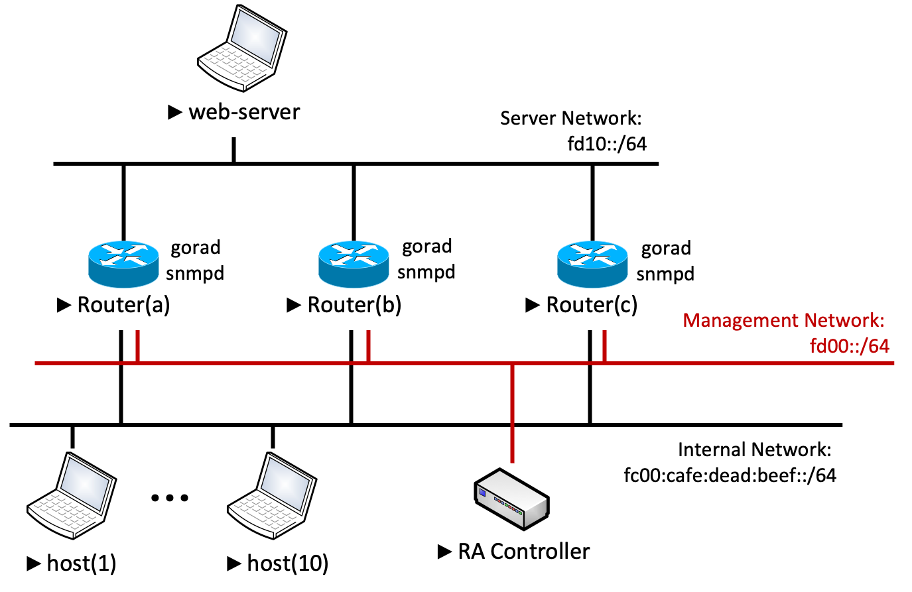

# Polaris Lab

A complete Polaris deployment on one machine: three site-exit routers (one
ISP each), ten end hosts, the RA controller, and a web server that plays the
Internet. One command starts it, one command proves that the policies work.

[English](README.md) / [日本語](README_ja.md)

## Quick start

Requirements: Docker (with Compose v2) and Python 3. Nothing else.

```bash
git submodule update --init      # fetch agent/go-ra (once)
cd laboratory
./lab up                         # build, start, wait until ready (~1 min the first time)
./lab demo                       # apply every scenario and verify each one
./lab down                       # stop and delete everything
```

`./lab demo` ends with `DEMO PASSED` when every host, in every scenario,
has exactly the routes the policy designates **and** its traffic leaves
through the designated ISP.

The web UI is at <http://localhost:3000> (`LAB_PORT=8000 ./lab up` to change
the port).

## Commands

| Command | What it does |
|---------|--------------|
| `./lab up` | Build and start the lab; wait until the routers are registered and every host has received the baseline RAs |
| `./lab demo` | `clear` → every scenario → `clear`, verifying the hosts after each step |
| `./lab scenarios` | List the built-in scenarios |
| `./lab apply <scenario>` | Replace the whole policy with a scenario and apply it |
| `./lab clear` | Remove every policy |
| `./lab verify` | Compare every host with the policy currently stored in the controller |
| `./lab status` | Show the RA configurations each router is running |
| `./lab down` | Stop the lab and delete its state |

## Topology



| Network | Subnet | Members |
|---------|--------|---------|
| `internal` | `fc00:cafe:dead:beef::/64` | host01–10, routers (RAs) |
| `upstream` | `fd10::/64` | routers, web server |
| `mgmt` | `fd00::/64` | controller, neighbor collector, routers (gRPC) |

| Router | Baseline RA source | Policy RA source | ISP prefix (NPTv6) |
|--------|--------------------|------------------|--------------------|
| Router(a) | kernel link-local | `fe80::face:1` | `2001:db8:a::/64` → ISP-A |
| Router(b) | kernel link-local | `fe80::face:2` | `2001:db8:b::/64` → ISP-B |
| Router(c) | kernel link-local | `fe80::face:3` | `2001:db8:c::/64` → ISP-C |

All hosts share the internal prefix. Each router translates it to its own ISP
prefix with NPTv6 (RFC 6296). The web server answers every request with the
ISP it came through, derived from the translated source address:

```
$ docker exec polaris-lab-host01-1 wget -qO- 'http://[2001:db8:f1::1]/'
isp=ISP-A client=2001:db8:a:0:... server=2001:db8:f1::1
```

The web server has two service addresses:

| Service | Address | Reached by |
|---------|---------|------------|
| S1 | `2001:db8:f1::1` | the per-destination rule for `2001:db8:f1::/48` (RIO), if the host has one |
| S2 | `2001:db8:f2::1` | the default route (DRP) |

## Two source addresses per router

A host keeps one default-router entry per RA **source address** and
overwrites its preference and lifetime with every RA from that address
(RFC 4861 §6.3.4, RFC 4191 §3.1). If the policy RA (preference high, sent to
selected hosts) and the baseline RA (preference medium, sent to all hosts)
came from the same address, each would undo the other.

Each router therefore has two link-local addresses on the internal interface:

- the **baseline address** sends the baseline RA: prefix, Router Lifetime
  1800 s, preference medium, to every host;
- the **policy address** sends only policy RAs, unicast, to the hosts of a
  policy.

On a host, they are two independent router entries:

```
$ docker exec polaris-lab-host06-1 ip -6 route show    # paper scenario, group G2
default via fe80::face:2            proto ra  pref high      ← policy RA of Router(b)
default via fe80::dc1f:…            proto ra  pref medium    ← baseline RA of Router(b)
default via fe80::10a3:…            proto ra  pref medium    ← baseline RA of Router(a)
default via fe80::7896:…            proto ra  pref medium    ← baseline RA of Router(c)
```

A policy RA is a default router (preference high, Router Lifetime > 0) only
when `::/0` is assigned to the router. Otherwise its Router Lifetime is 0: it
carries Route Information Options and nothing else, so the policy address
appears only as the next hop of those routes.

Withdrawing a policy is one RA from the policy address with zero lifetimes.
The baseline entries are untouched, so the host falls back to them at once.

## Scenarios

| Scenario | Policy | What it shows |
|----------|--------|---------------|
| `paper` | G1 host01–05: S1 prefix via Router(a). G2 host06–10: default via Router(b) | The example of the paper: RIO and DRP policies side by side |
| `swap` | G1 → Router(c), G2 → Router(a) | Transition: the new routers are advertised before the old ones are withdrawn |
| `overlap` | G1 host01–07: S1 prefix via Router(a). G2 host04–10: default via Router(b) | host04–07 follow two rules on two routers |
| `merge` | G1 host01–05: S1 prefix via Router(a). G2 host03–05: default via Router(a) | Two rules for one router become one policy RA per host |
| `clear` | none | Every policy is withdrawn; hosts return to the baseline |

## What `verify` checks

For every host, against the rules and groups stored in the controller:

1. **Routing table.** The RA-learned routes are exactly the designated ones:
   each RIO route via the policy address of its router, a high-preference
   default router if and only if the policy assigns `::/0`, and a
   medium-preference baseline entry for all three routers. A leftover route
   from a previous policy is a failure.
2. **Forwarding.** An HTTP request to S1 and to S2 returns, and the web
   server reports the ISP of the designated router. Where the policy
   designates no router, any ISP is accepted.

The expectation is computed by the lab tooling from the rules and groups,
independently of the controller's compiler.

```
  HOST    S1 2001:db8:f1::1             S2 2001:db8:f2::1             ROUTING TABLE
  host01  ISP-A (policy: Router(a))     ISP-C (no policy)             matches policy
  host06  ISP-B (policy: Router(b))     ISP-B (policy: Router(b))     matches policy
  ...
  PASS: 10/10 hosts match the policy (routing table and egress ISP).
```

## Kernel support for Route Information Options

Linux processes RIOs only if the kernel was built with
`CONFIG_IPV6_ROUTE_INFO` **and** `accept_ra_rt_info_max_plen` is raised from
its default of 0. `./lab up` detects which case applies:

| Docker host kernel | What the lab does |
|--------------------|-------------------|
| Supports RIO (most Linux distributions) | Sets `accept_ra_rt_info_max_plen=128` on the hosts (`docker-compose.kernel-rio.yaml`). The kernel handles everything |
| No RIO support (Docker Desktop on macOS / Windows) | Starts `rio-shim` on each host: a small program that installs the routes of received RIOs the way the kernel would. Default routers and preferences are still handled by the kernel |

`./lab up` prints which mode is in use. Results obtained with `rio-shim` show
that the routers send the right RAs; they are not evidence of how a kernel
processes RIOs. For that, run the lab on a Linux host.

## Building from another go-ra checkout

The router image is built from the `agent/go-ra` submodule. To build from a
different checkout:

```bash
GO_RA_DIR=/path/to/go-ra ./lab up
```

## Files

```
laboratory/
├── lab                              the command
├── labkit/                          its Python modules (env, scenarios, verify)
├── docker-compose.yaml              topology
├── docker-compose.kernel-rio.yaml   RIO sysctl for hosts, added when the kernel supports it
├── Dockerfile.*                     images: agent, host, backend, frontend, collector, web server
├── entrypoint-agent.sh              router: NPTv6, two link-local addresses, go-ra, registration
├── entrypoint-host.sh               host: RA-only default routes, RIO handling
├── entrypoint-webserver.sh          service addresses and per-ISP return routes
├── nginx-webserver.conf             "which ISP did you come through" responder
├── nginx.conf                       web UI and /api proxy
└── rio-shim/                        RIO fallback for kernels without CONFIG_IPV6_ROUTE_INFO
```

## Troubleshooting

- **`./lab up` times out.** Run `./lab status`, then
  `docker compose -f docker-compose.yaml logs router1 controller-backend`.
- **`go-ra source not found`.** Run `git submodule update --init` in the
  repository root, or set `GO_RA_DIR`.
- **A host shows `MISMATCH`.** The lines under it say what differs. Inspect
  the host with `docker exec polaris-lab-host01-1 ip -6 route show`, and the
  routers with `./lab status`.
- **Clients tab lists stale hosts.** Entries of containers from an earlier
  `./lab up` stay in the routers' neighbor caches for a while. `./lab down`
  followed by `./lab up` starts clean.
