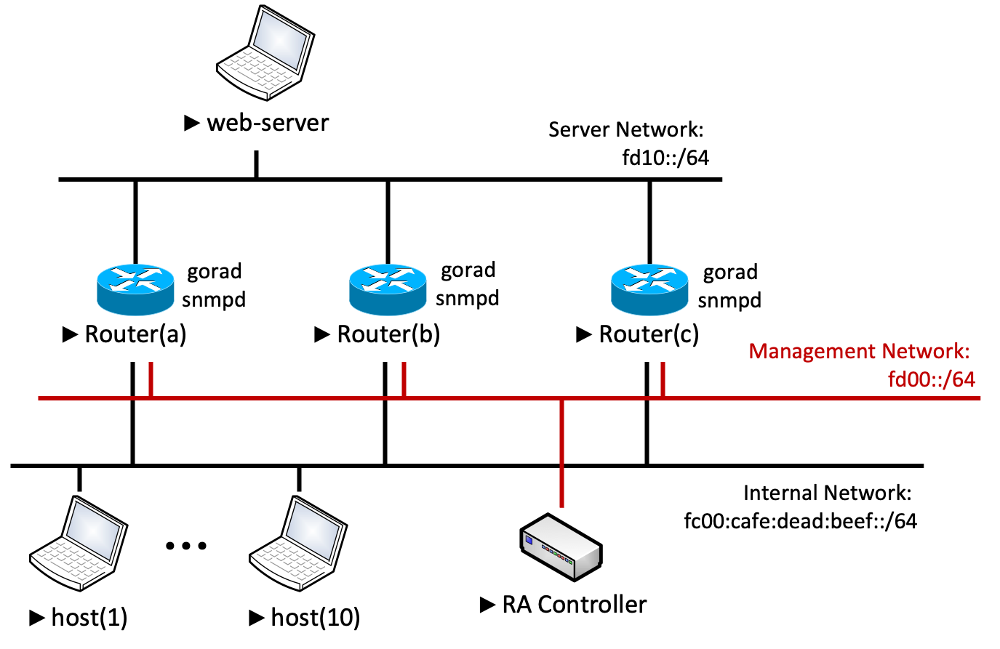

# Polaris Lab

1 台のマシンで動く Polaris 一式です。サイト出口ルータ 3 台（それぞれ別の ISP）、
エンドホスト 10 台、RA コントローラ、インターネット役の Web サーバで構成されます。
1 コマンドで起動し、1 コマンドでポリシーが効いていることを確認できます。

[English](README.md) / [日本語](README_ja.md)

## クイックスタート

必要なものは Docker（Compose v2）と Python 3 だけです。

```bash
git submodule update --init      # agent/go-ra を取得（初回のみ）
cd laboratory
./lab up                         # ビルドして起動し、準備完了まで待つ（初回は 1 分ほど）
./lab demo                       # 全シナリオを適用し、毎回検証する
./lab down                       # 停止してすべて削除する
```

`./lab demo` は、すべてのシナリオですべてのホストが「ポリシーどおりの経路だけを持ち」、
かつ「ポリシーどおりの ISP から出ている」とき、最後に `DEMO PASSED` を表示します。

Web UI は <http://localhost:3000> です（ポートを変えるには `LAB_PORT=8000 ./lab up`）。

## コマンド

| コマンド | 動作 |
|----------|------|
| `./lab up` | ビルドして起動する。ルータの登録と、全ホストへのベースライン RA の到達を待つ |
| `./lab demo` | `clear` → 全シナリオ → `clear` の順に適用し、各ステップでホストを検証する |
| `./lab scenarios` | 組み込みシナリオの一覧を表示する |
| `./lab apply <scenario>` | ポリシー全体をシナリオで置き換えて適用する |
| `./lab clear` | すべてのポリシーを削除する |
| `./lab verify` | コントローラに保存されているポリシーと全ホストを照合する |
| `./lab status` | 各ルータで動いている RA 設定を表示する |
| `./lab down` | 停止して状態を削除する |

## トポロジ



| ネットワーク | サブネット | メンバー |
|--------------|------------|----------|
| `internal` | `fc00:cafe:dead:beef::/64` | host01〜10、ルータ（RA） |
| `upstream` | `fd10::/64` | ルータ、Web サーバ |
| `mgmt` | `fd00::/64` | コントローラ、neighbor collector、ルータ（gRPC） |

| ルータ | ベースライン RA の送信元 | ポリシー RA の送信元 | ISP プレフィクス（NPTv6） |
|--------|--------------------------|----------------------|---------------------------|
| Router(a) | カーネルが付けたリンクローカル | `fe80::face:1` | `2001:db8:a::/64` → ISP-A |
| Router(b) | カーネルが付けたリンクローカル | `fe80::face:2` | `2001:db8:b::/64` → ISP-B |
| Router(c) | カーネルが付けたリンクローカル | `fe80::face:3` | `2001:db8:c::/64` → ISP-C |

全ホストは同じ内部プレフィクスを使います。各ルータはそれを NPTv6（RFC 6296）で
自分の ISP プレフィクスに変換します。Web サーバは、変換後の送信元アドレスから
「どの ISP 経由で来たか」を判定して返します。

```
$ docker exec polaris-lab-host01-1 wget -qO- 'http://[2001:db8:f1::1]/'
isp=ISP-A client=2001:db8:a:0:... server=2001:db8:f1::1
```

Web サーバにはサービス用アドレスが 2 つあります。

| サービス | アドレス | 使われる経路 |
|----------|----------|--------------|
| S1 | `2001:db8:f1::1` | `2001:db8:f1::/48` 向けの宛先別ルール（RIO）。ホストにそのルールがある場合 |
| S2 | `2001:db8:f2::1` | デフォルトルート（DRP） |

## ルータごとに送信元アドレスを 2 つ持つ理由

ホストは RA の**送信元アドレス**ごとにデフォルトルータのエントリを 1 つ持ち、
そのアドレスから RA を受けるたびに優先度と lifetime を上書きします
（RFC 4861 6.3.4 節、RFC 4191 3.1 節）。ポリシー RA（優先度 high、特定ホスト宛）と
ベースライン RA（優先度 medium、全ホスト宛）が同じアドレスから出ると、
互いの設定を打ち消してしまいます。

そこで各ルータは、内部インターフェースにリンクローカルアドレスを 2 つ持ちます。

- **ベースライン用アドレス**: ベースライン RA を全ホストへ送る
  （プレフィクス、Router Lifetime 1800 秒、優先度 medium）。
- **ポリシー用アドレス**: ポリシー RA だけを、対象ホストへユニキャストで送る。

ホストから見ると、この 2 つは独立したルータエントリです。

```
$ docker exec polaris-lab-host06-1 ip -6 route show    # paper シナリオ、グループ G2
default via fe80::face:2            proto ra  pref high      ← Router(b) のポリシー RA
default via fe80::dc1f:…            proto ra  pref medium    ← Router(b) のベースライン RA
default via fe80::10a3:…            proto ra  pref medium    ← Router(a) のベースライン RA
default via fe80::7896:…            proto ra  pref medium    ← Router(c) のベースライン RA
```

ポリシー RA がデフォルトルータ（優先度 high、Router Lifetime > 0）になるのは、
そのルータに `::/0` が割り当てられたときだけです。それ以外では Router Lifetime は 0 で、
Route Information Option だけを運びます。このときポリシー用アドレスは、
その経路の next hop としてだけ現れます。

ポリシーの取り下げは、ポリシー用アドレスから lifetime 0 の RA を 1 通送るだけです。
ベースラインのエントリには触れないので、ホストはすぐにベースラインへ戻ります。

## シナリオ

| シナリオ | ポリシー | 確認できること |
|----------|----------|----------------|
| `paper` | G1 host01〜05: S1 のプレフィクスを Router(a) 経由。G2 host06〜10: デフォルトを Router(b) | 論文の例。RIO と DRP のポリシーを同時に使う |
| `swap` | G1 → Router(c)、G2 → Router(a) | 遷移。新しいルータを広告してから古いルータを取り下げる |
| `overlap` | G1 host01〜07: S1 のプレフィクスを Router(a) 経由。G2 host04〜10: デフォルトを Router(b) | host04〜07 が 2 台のルータの 2 つのルールに従う |
| `merge` | G1 host01〜05: S1 のプレフィクスを Router(a) 経由。G2 host03〜05: デフォルトを Router(a) | 同じルータ向けの 2 ルールが、ホストごとに 1 通のポリシー RA にまとまる |
| `clear` | なし | すべてのポリシーを取り下げ、ホストがベースラインへ戻る |

## `verify` が確認する内容

コントローラに保存されているルールとグループを基準に、ホストごとに次を確認します。

1. **経路表**: RA で学習した経路がポリシーの指定と完全に一致すること。
   RIO の経路は指定ルータのポリシー用アドレス経由であること。
   優先度 high のデフォルトルータは、ポリシーが `::/0` を割り当てたときだけ存在すること。
   3 台すべてのルータについて、優先度 medium のベースラインのエントリがあること。
   以前のポリシーの経路が残っていれば失敗です。
2. **転送**: S1 と S2 への HTTP リクエストに応答が返り、Web サーバが報告する ISP が
   指定ルータの ISP であること。ポリシーがルータを指定していない宛先は、どの ISP でも可とします。

期待値は、lab のツールがルールとグループから独自に計算します。
コントローラのコンパイラの結果は使いません。

```
  HOST    S1 2001:db8:f1::1             S2 2001:db8:f2::1             ROUTING TABLE
  host01  ISP-A (policy: Router(a))     ISP-C (no policy)             matches policy
  host06  ISP-B (policy: Router(b))     ISP-B (policy: Router(b))     matches policy
  ...
  PASS: 10/10 hosts match the policy (routing table and egress ISP).
```

## Route Information Option のカーネル対応

Linux が RIO を処理するのは、カーネルが `CONFIG_IPV6_ROUTE_INFO` 付きでビルドされ、
**かつ** `accept_ra_rt_info_max_plen` を既定値の 0 から上げた場合だけです。
`./lab up` はどちらの環境かを判定します。

| Docker ホストのカーネル | lab の動作 |
|-------------------------|------------|
| RIO に対応（多くの Linux ディストリビューション） | ホストに `accept_ra_rt_info_max_plen=128` を設定する（`docker-compose.kernel-rio.yaml`）。すべてカーネルが処理する |
| RIO に非対応（macOS / Windows の Docker Desktop） | 各ホストで `rio-shim` を起動する。受信した RIO の経路を、カーネルと同じ形でインストールする小さなプログラム。デフォルトルータと優先度の処理はカーネルのまま |

どちらのモードで動いているかは `./lab up` が表示します。
`rio-shim` を使った結果は「ルータが正しい RA を送っている」ことを示しますが、
「カーネルが RIO をどう処理するか」の証拠にはなりません。後者を確認するには
Linux ホストで lab を動かしてください。

## 別の go-ra チェックアウトからビルドする

ルータのイメージは `agent/go-ra` サブモジュールからビルドします。
別のチェックアウトを使うには次のようにします。

```bash
GO_RA_DIR=/path/to/go-ra ./lab up
```

## ファイル

```
laboratory/
├── lab                              コマンド本体
├── labkit/                          その Python モジュール（env, scenarios, verify）
├── docker-compose.yaml              トポロジ
├── docker-compose.kernel-rio.yaml   ホスト用の RIO sysctl。カーネルが対応しているときだけ追加
├── Dockerfile.*                     イメージ: agent, host, backend, frontend, collector, web server
├── entrypoint-agent.sh              ルータ: NPTv6、リンクローカル 2 つ、go-ra、登録
├── entrypoint-host.sh               ホスト: RA 由来のデフォルトルートのみ、RIO の処理
├── entrypoint-webserver.sh          サービス用アドレスと ISP ごとの戻り経路
├── nginx-webserver.conf             「どの ISP 経由で来たか」を返す設定
├── nginx.conf                       Web UI と /api プロキシ
└── rio-shim/                        CONFIG_IPV6_ROUTE_INFO のないカーネル向けの RIO 代替処理
```

## トラブルシューティング

- **`./lab up` がタイムアウトする**: `./lab status` を実行し、次に
  `docker compose -f docker-compose.yaml logs router1 controller-backend` を確認します。
- **`go-ra source not found`**: リポジトリのルートで `git submodule update --init` を実行するか、
  `GO_RA_DIR` を設定します。
- **ホストが `MISMATCH` になる**: 直下の行に差分が出ます。ホストは
  `docker exec polaris-lab-host01-1 ip -6 route show`、ルータは `./lab status` で確認します。
- **Clients タブに古いホストが残る**: 以前の `./lab up` のコンテナのエントリが、
  ルータの近隣キャッシュにしばらく残ります。`./lab down` のあと `./lab up` すれば消えます。
